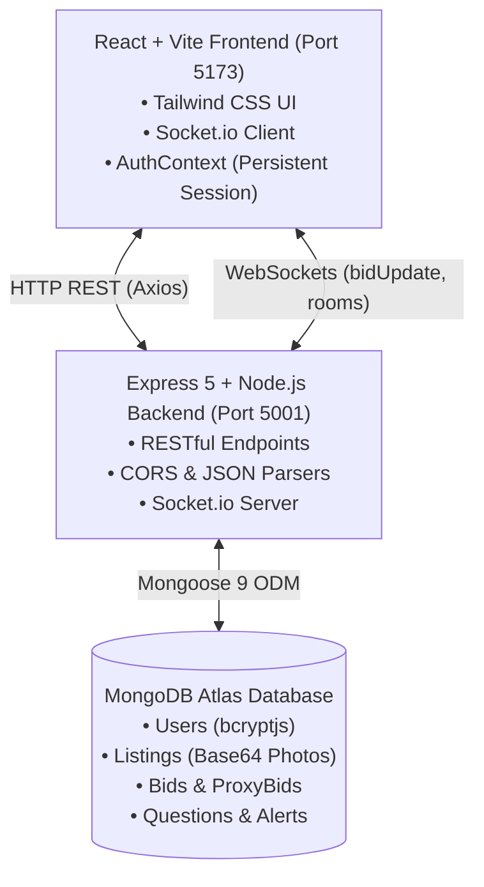

# 🎓 CampusAuction — The Next-Gen Campus Bidding Marketplace

[](https://react.dev/)
[](https://tailwindcss.com/)
[](https://nodejs.org/)
[](https://socket.io/)
[](https://www.mongodb.com/)
[](LICENSE)

**CampusAuction** is a full-stack, real-time campus auction and peer-to-peer commerce marketplace tailored specifically for university students. From buying and selling campus cycles, engineering textbooks, and lab gear to dorm essentials and electronics, CampusAuction pairs live WebSocket bidding with an **Automatic Proxy Bidding Engine**, an **AI Autonomous Bidding Agent**, and **Smart Watchlist Alerts**.

---

## 🌟 Key Features

### 1. ⚡ Live Real-Time Bidding Engine
- **Instant WebSockets (Socket.io)**: Every bid updates in real time across all active user browsers without page refreshes.
- **Strict Anti-Self-Bidding Guard**: Sellers are strictly prohibited by both backend middleware and frontend validation from bidding on their own listings (`sellerId === userId` check).
- **Dynamic Bid Increments**: Enforces configurable minimum increments (`minIncrement`) above current bids.
- **Closing Time Countdown**: Live timers alert students when auctions are in their final minutes.

### 2. 🤖 Official Automatic Proxy Bidding Engine
- **Max Ceiling Budgeting**: Buyers can specify their maximum absolute budget (e.g. ₹1,800) using the **"Auto-Bid / Set Max Limit"** mode.
- **Automated Background Counter-Bid Trigger**: When a competing student submits a standard or proxy bid, the background trigger (`executeProxyBiddingTrigger`) automatically places the minimum necessary counter-bid on behalf of the proxy bidder, keeping them safely in the lead up to their ceiling.
- **Anti-Self-Outbidding Safety**: Leading bidders can raise their ceiling cap at any time without triggering a counter-bid against themselves.
- **Visual Status Badges**: Displays a live `🤖 Auto-Bidder Holding Lead (Proxy Active)` badge when an auto-bidder holds the winning position.

### 3. 🧠 AI Autonomous Bidding Agent & Price Valuation
- **Natural Language Matching**: Students can enter prompts like *"Find me an engineering cycle under ₹2,000"* or *"Textbooks for sem 2 physics"*.
- **Autonomous Proxy Authorization**: The AI agent analyzes current listings, calculates the next valid bid, and allows users to authorize automated proxy bidding within their designated ceiling.
- **Campus Fair Price Calculator**: Algorithms estimate market value based on item age, functional condition, and category depreciation to prevent overpaying.

### 4. 🔔 "Never Miss What You Need" Watchlist & Alert System
- **Custom Search Triggers**: Students set up alerts matching keywords (e.g., *"scientific calculator"*, *"drafter"*), categories, and maximum budget limits.
- **Automated Listing Creation Hook**: Whenever a new listing is published, an automated database trigger scans user alerts and immediately generates targeted notifications for interested buyers.
- **Notification Center**: Interactive alert bell and dedicated `/alerts` management page.

### 5. 💬 Interactive Community Q&A with Seller Responses
- **Public Inquiry Board**: Prospective buyers ask public questions directly on listing pages.
- **Verified Seller Answers**: The item's seller has a dedicated response interface to post official clarifications and answers (`POST /api/listings/:id/questions/:questionId/answer`).

### 6. 🛡️ Database-Backed Authentication & Access Control
- **Secure Credentials**: Passwords hashed using `bcryptjs` with salt rounds.
- **Distinct Flows**: Separate dedicated Register and Login screens with input validation.
- **Persistent Context**: React `AuthContext` syncs authentication tokens and profile data to `localStorage`.
- **Protected Client Routes**: Guards `/create`, `/my-listings`, `/my-bids`, and `/alerts` using `ProtectedRoute.jsx`.

### 7. 📦 Seller & Buyer Dashboards
- **My Listings (`/my-listings`)**: Sellers track active items, live bid counts, edit prices/descriptions via an interactive modal, or cancel/delete listings.
- **My Bids & Purchases (`/my-bids`)**: Buyers review all active bids, highest bids, and won auctions.

---

## 🏗️ System Architecture



---

## 📂 Project Directory Structure

```text
TheCloudCompany/
├── backend/
│   ├── models/
│   │   ├── Alert.js           # Watchlist alerts (userId, keyword, maxPrice, category)
│   │   ├── Bid.js             # Listing bids (listingId, bidderId, amount, isProxy)
│   │   ├── Listing.js         # Auction items (photos, price, minIncrement, closingTime)
│   │   ├── Notification.js    # In-app alert match notifications
│   │   ├── ProxyBid.js        # Automatic proxy ceilings (listingId, userId, maxAmount)
│   │   ├── Question.js        # Listing Q&A entries and seller answers
│   │   └── User.js            # User accounts (name, email, password hash, role)
│   ├── routes/
│   │   ├── aiAgentRoutes.js   # AI natural language search, valuation & auto-bid agent
│   │   └── auctionRoutes.js   # Auth, listings CRUD, bidding, proxy engine, Q&A, alerts
│   └── server.js              # Express app, Socket.io rooms, MongoDB connection
├── frontend/
│   ├── src/
│   │   ├── components/
│   │   │   ├── ListingCard.jsx      # Marketplace auction item card with live countdown
│   │   │   ├── Navbar.jsx           # App navigation, notifications badge & user menu
│   │   │   └── ProtectedRoute.jsx   # Route guard for authenticated actions
│   │   ├── context/
│   │   │   └── AuthContext.jsx      # Global user session provider
│   │   ├── pages/
│   │   │   ├── AIAssistant.jsx      # AI natural language finder & price calculator
│   │   │   ├── Alerts.jsx           # Watchlist and alert notifications management
│   │   │   ├── CreateListing.jsx    # Item publication form with Base64 image upload
│   │   │   ├── Home.jsx             # Marketplace feed with search and category filters
│   │   │   ├── ListingDetail.jsx    # Live bidding, proxy ceiling form, Q&A section
│   │   │   ├── Login.jsx            # User sign-in page
│   │   │   ├── MyListings.jsx       # Seller management dashboard with edit/cancel
│   │   │   ├── MyPurchases.jsx      # Buyer bidding history and purchases
│   │   │   └── Register.jsx         # User registration page
│   │   ├── services/
│   │   │   ├── api.js               # Centralized Axios API client
│   │   │   └── socket.js            # Socket.io connection instance
│   │   ├── App.jsx                  # React Router configuration
│   │   └── main.jsx                 # Vite application mount
│   ├── package.json
│   └── vite.config.js
├── .env.example                     # Sample environment configuration
├── package.json                     # Root configuration and run scripts
└── README.md                        # Project documentation
```

---

## 🛠️ Technology Stack

| Domain | Technology | Description |
| :--- | :--- | :--- |
| **Frontend** | React 19 + Vite | High-performance SPA with client-side routing |
| **Styling** | Tailwind CSS | Modern styling system with responsive utility classes |
| **Icons** | Lucide React | Clean, lightweight UI icons |
| **Real-Time** | Socket.io Client | Bid updates and listing room events |
| **Backend** | Node.js + Express 5 | RESTful API server with custom route handlers |
| **Database** | MongoDB Atlas | Cloud-hosted NoSQL document store |
| **ODM** | Mongoose 9 | Object data modeling, schema validation, indexing |
| **Security** | bcryptjs | Secure salted password hashing |

---

## 🚀 Getting Started

### 1. Prerequisites
- **Node.js** (v18 or higher recommended)
- **npm** (v9 or higher)
- **MongoDB Atlas** account (or local MongoDB instance)

### 2. Environment Variables Configuration
Create a `.env` file in the project root:

```env
PORT=5001
MONGO_URI=mongodb+srv://<username>:<password>@<cluster>.mongodb.net/campus_auction?retryWrites=true&w=majority
CLIENT_URL=http://localhost:5173
```

> **Note**: Port `5001` is used by default on macOS to avoid port conflicts with Apple's AirPlay Receiver.

### 3. Installation

Install dependencies for both backend and frontend:

```bash
# Install root/backend dependencies
npm install

# Install frontend dependencies
npm --prefix frontend install
```

### 4. Running the Development Servers

You can run both backend and frontend concurrently:

```bash
# Terminal 1 — Start the Backend Server (Port 5001)
npm run dev

# Terminal 2 — Start the Frontend Development Server (Port 5173)
npm run client
# Or: cd frontend && npm run dev
```

Open your browser at **`http://localhost:5173`**.

---

## 📡 API Endpoints Reference

### Authentication (`/api/users`)
| Method | Endpoint | Description |
| :--- | :--- | :--- |
| `POST` | `/api/users/register` | Register a new student account (`name`, `email`, `password`) |
| `POST` | `/api/users/login` | Authenticate existing student and return profile |

### Listings (`/api/listings`)
| Method | Endpoint | Description |
| :--- | :--- | :--- |
| `GET` | `/api/listings` | Fetch active listings (supports `search`, `category`, `sort`) |
| `GET` | `/api/listings/:id` | Fetch listing details, bid history, proxy status, and Q&A |
| `POST` | `/api/listings` | Create a new listing (with Base64 photos; triggers alert matching) |
| `PUT` | `/api/listings/:id` | Update listing details (seller verification enforced) |
| `DELETE` | `/api/listings/:id` | Cancel or delete listing (seller verification enforced) |
| `GET` | `/api/listings/user/:userId` | Get all listings created by a specific seller |

### Bidding & Automatic Proxy Bidding
| Method | Endpoint | Description |
| :--- | :--- | :--- |
| `POST` | `/api/listings/:id/bid` | Place a manual bid or register max proxy ceiling (`amount`, `maxAmount`) |
| `POST` | `/api/listings/:id/proxy-bid` | Explicitly register or adjust a user's automatic proxy ceiling |
| `GET` | `/api/listings/:id/proxy-bid/:userId` | Retrieve a user's current proxy ceiling for a listing |
| `GET` | `/api/listings/bids/:userId` | Get bidding history and active leads for a buyer |

### Community Questions & Answers
| Method | Endpoint | Description |
| :--- | :--- | :--- |
| `POST` | `/api/listings/:id/questions` | Ask a question on an auction listing |
| `POST` | `/api/listings/:id/questions/:questionId/answer` | Seller response endpoint (seller verification enforced) |

### Watchlists & Alerts (`/api/alerts`)
| Method | Endpoint | Description |
| :--- | :--- | :--- |
| `POST` | `/api/alerts` | Create a new search alert (`keyword`, `maxPrice`, `category`) |
| `GET` | `/api/alerts/:userId` | Fetch user alerts and unread matched notifications |
| `DELETE` | `/api/alerts/:id` | Delete an active alert |
| `PATCH` | `/api/alerts/notifications/:id/read` | Mark a notification as read |

### AI Autonomous Agent (`/api/ai`)
| Method | Endpoint | Description |
| :--- | :--- | :--- |
| `POST` | `/api/ai/search` | Natural language item search with market price estimation |
| `POST` | `/api/ai/auto-bid` | Authorize AI agent proxy bid with budget cap verification |

---

## ⚡ Socket.io WebSocket Events

| Event Name | Direction | Payload | Description |
| :--- | :--- | :--- | :--- |
| `joinListing` | Client → Server | `listingId` | Joins the real-time room for a specific listing |
| `leaveListing` | Client → Server | `listingId` | Leaves the listing room |
| `bidUpdate` | Server → Client | `{ listingId, currentBid, bid, hasProxyLead, isAutoBid }` | Broadcasted on every manual or automated proxy bid |
| `newQuestion` | Server → Client | `{ listingId, question }` | Broadcasted when a new question is submitted |
| `questionAnswered` | Server → Client | `{ listingId, question }` | Broadcasted when the seller replies to a question |

---

## 🧪 Testing the Proxy Bidding Workflow

You can verify the automatic proxy bidding engine via curl:

```bash
# 1. User A sets a proxy bid ceiling of ₹3,600 on a ₹3,200 item (min increment = ₹100):
curl -X POST http://localhost:5001/api/listings/<LISTING_ID>/bid \
  -H "Content-Type: application/json" \
  -d '{"bidderId":"<USER_A_ID>","bidderName":"User A","amount":3300,"maxAmount":3600}'

# 2. User B places a manual bid of ₹3,400:
curl -X POST http://localhost:5001/api/listings/<LISTING_ID>/bid \
  -H "Content-Type: application/json" \
  -d '{"bidderId":"<USER_B_ID>","bidderName":"User B","amount":3400}'

# -> Result: The backend trigger immediately auto-counters for User A at ₹3,500.
# -> User A remains in the lead (hasProxyLead: true).

# 3. User B outbids the ceiling with ₹3,700:
curl -X POST http://localhost:5001/api/listings/<LISTING_ID>/bid \
  -H "Content-Type: application/json" \
  -d '{"bidderId":"<USER_B_ID>","bidderName":"User B","amount":3700}'

# -> Result: User B takes the lead at ₹3,700; hasProxyLead transitions to false.
```

---

## 📄 License
This project is licensed under the ISC License.
